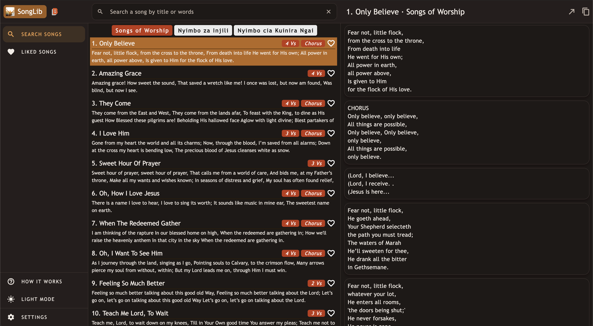
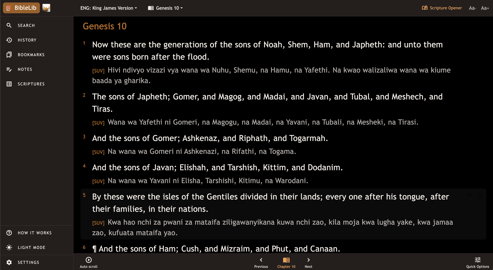

# ChurchLib

ChurchLib is a Flutter desktop app that brings [SongLib](https://sirodevs.com/songlib) and [BibleLib](https://sirodevs.com/biblelib) together for church services. It runs on Windows, macOS, and Linux and keeps downloaded songbooks and Bible translations available offline.

## Features

### SongLib

- Choose the songbooks used by your church and browse songs by book.
- Search by song number, title, alias, or lyric text. Search ignores case and common punctuation, accepts terms in any order, and tolerates small spelling mistakes.
- Keep liked songs, recent history, personal song lists, and song drafts. Create and edit your own songs and lists.
- Copy or share a complete song or an individual verse.
- Present lyrics one verse at a time, move between verses and songs, and optionally keep a verse list visible while presenting.

### BibleLib

- Choose Bible translations to download, set a primary translation, and add secondary translations for parallel reading.
- Browse books and chapters, search downloaded translations, and open passages directly with Scripture Opener.
- Build passage queues and reusable scripture lists. Reading and search history make it easy to return to previous passages.
- Select verses to copy, bookmark, highlight, or annotate. Bookmarks, notes, and reading history are available in the sidebar.
- Adjust reader text size and use auto-scroll with speed changes in 0.1 steps.

### Presentation and service use

- Present a song or Bible passage on an extended display. The operator view keeps the source app and a slide preview, navigation controls, and (for songs) the verse list together.
- If audience mode is turned off, the second display is mirrored, or no extended display is available, presentation opens full screen on the current display.
- Change song slide direction, show or hide the song verse list, resize presentation text, and black out the audience output when needed.
- Keyboard controls include slide and verse navigation, font sizing, blackout, and closing presentation. Song presentation also supports jumping to a numbered verse, the chorus, or the last slide; `Ctrl+F` returns to song search.

### Setup, settings, and offline use

- Choose SongLib, BibleLib, or both during setup. The other module can be added later from Settings.
- Choose a system, light, or dark theme; toggle audience mode; and configure song presentation direction and verse-list visibility.
- Songbooks, downloaded Bibles, bookmarks, notes, lists, drafts, and history are stored locally. Network access is needed for initial content downloads, song updates, licensing, and application version checks.
- ChurchLib supports English (default), Swahili, Arabic, Spanish, French, and Portuguese. The app follows the operating system language when it is supported; Arabic uses right-to-left layout.

### Licensing and updates

- Start a free trial, check license status, redeem a license key, or submit payment details for activation.
- Release a license from the current computer when moving it to another one. The app checks for updated license status and displays available version updates.

## Screenshots

| SongLib | BibleLib |
|:--:|:--:|
|  |  |

## Main packages

Runtime dependencies are declared in [`pubspec.yaml`](pubspec.yaml). These are the main packages and their roles:

| Area | Packages | Role in ChurchLib |
|---|---|---|
| App framework | `flutter`, `flutter_localizations`, `intl` | Desktop UI, localized strings, and date/number formatting. |
| State and routing | `flutter_bloc`, `equatable`, `freezed_annotation`, `go_router` | Feature state, value equality, generated state types, and navigation. |
| Dependency injection | `get_it`, `injectable` | Register and retrieve app services and repositories. |
| Local data | `froom`, `sqflite`, `shared_preferences`, `path`, `path_provider`, `json_annotation` | SQLite models and queries, user preferences, local paths, and JSON model definitions. |
| Network | `http`, `connectivity_plus` | Fetch song and Bible data, check connectivity, and handle update or license requests. |
| Desktop integration | `multiview_desktop`, `device_info_plus`, `flutter_platform_alert` | Multi-window audience display, device details, and native platform alerts. |
| Interface | `styled_widget`, `card_swiper`, `skeleton_loader`, `percent_indicator`, `textstyle_extensions`, `dartx` | Widget composition, swipeable content, loading states, progress indicators, and text/layout helpers. |
| Licensing and updates | `crypto`, `cryptography`, `package_info_plus`, `url_launcher`, `timeago` | Device identifiers, license verification, app version checks, links, and relative dates. |
| Export and sharing | `pdf`, `share_plus` | Create PDF output and share song content. |

Development dependencies include `build_runner`, `froom_generator`, `json_serializable`, `freezed`, and `injectable_generator` for generated code; `flutter_lints` for static analysis; `flutter_test` for tests; and `import_sorter` for import organization.

Some packages declared in `pubspec.yaml` currently have no direct import under `lib/` or `test/`: `context_menus`, `cupertino_icons`, `flutter_svg`, `nativeapi_flutter`, `permission_handler`, `rxdart`, `sizer`, and `wakelock_plus`. They may support platform or future integrations; check their usage before removing them.

## Development setup

Requirements: Flutter with Dart SDK `3.13.5` or newer in the `3.x` range, plus the desktop build tools for your operating system.

```bash
git clone git@github.com:SiroDevs/ChurchLib.git
cd ChurchLib
flutter pub get
dart run build_runner build --delete-conflicting-outputs
flutter gen-l10n
```

Run the production configuration:

```bash
flutter run -t lib/main.dart
```

Run the staging configuration:

```bash
flutter run -t lib/main_stg.dart
```

Run the project tests with:

```bash
flutter test
```

## Build

Build the production desktop app for your platform:

```bash
flutter build windows -t lib/main.dart --no-tree-shake-icons
flutter build macos -t lib/main.dart --no-tree-shake-icons
flutter build linux -t lib/main.dart --no-tree-shake-icons
```

Only run the build command for the platform you are targeting. Linux packages can be produced with [`flutter_distributor`](https://pub.dev/packages/flutter_distributor) when it is installed.
